<p align="center">
  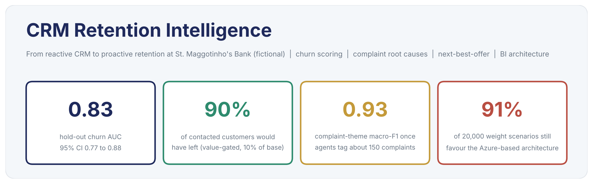
</p>

<p align="center">
  
  
  
  
  
  
  
</p>

# CRM Retention Intelligence

**From reactive CRM to proactive retention: which customers to call, what is worth spending on them, which complaints cost the most, and which offer to show.**

A reproducible analytics pipeline that turns a Business Intelligence portfolio ("CRM Optimization at St. Maggotinho's Bank", a fictional bank) into working code, back-tests and a management decision brief. Every number in this README is produced by `scripts/run_pipeline.py` and stored in [`outputs/metrics.json`](outputs/metrics.json).

> **Read this first: what is measured and what is assumed.**
> The data is synthetic (seed 42, 1,200 customers) and regenerated by this repository, so scores will differ slightly from the original PDF.
> Model quality, targeting precision and offer hit-rates are **measured** on held-out data. **Euro figures are scenarios** built on stated assumptions (offer cost, save rate, customer value) that live in [`src/crm_bi/config.py`](src/crm_bi/config.py), and the sensitivity analysis shows how far they can move. Only a controlled pilot can confirm them.

---

## The business story in one minute

| | |
|---|---|
| **Situation** | The bank loses about **1 in 4 customers** (24.7% churn) and handles complaints and cross-selling by instinct and generic scripts. |
| **Complication** | Calling everyone is not an option: at €45 per retention contact, a blanket campaign **loses about €26,400 per 1,000 customers** in the base scenario. Calling people at random loses about €5,300. |
| **Resolution** | Score every customer, call only those where the expected saved revenue exceeds the cost of the call, fix the billing problems that drive churn, and recommend offers from a model that beats the generic script in a back-test. |
| **Payoff (scenario)** | The value-gated policy contacts **10% of customers**; **90% of them would have left**. Net value is about **+€3,000 per 1,000 customers**, which is **+€8,300 better than random outreach** (95% CI €7.0k to €9.5k). |

## What management should do

| Decision | Evidence (measured) | Translation for managers |
|---|---|---|
| **1. Call a short, value-gated list, not everyone.** | Churn model hold-out AUC **0.83** (95% CI 0.77 to 0.88). The top 20% by risk contains **55%** of churners; the gated list of 29 of 300 customers has **90% precision**. | Spend the retention budget where a call is likely to pay for itself. Past about 10 to 20% of the base, every extra call loses money. |
| **2. Treat billing and fee complaints as a revenue problem.** | Billing & fees is **29% of complaints but 34% of revenue lost** to churned complainers; customers who complain churn at **40% vs 25%** overall. | Fixing fee communication and billing errors has a higher return than adding agents elsewhere. |
| **3. Have agents tag complaints, then automate.** | Unsupervised clustering agrees poorly with the true themes (ARI 0.13). A supervised classifier reaches **macro-F1 0.93**, and **about 150 tagged complaints** already give 0.91. | A two-week tagging effort buys a reliable complaint dashboard. Do not trust unlabeled topic clusters for reporting. |
| **4. Put a propensity model behind the next-best-offer, not lift-ranked rules.** | Back-test, hit@2: generic script **70.0%**, lift-ranked rules **54.2%** (worse), propensity model **76.8%** (+6.8 points, CI +3.7 to +9.8). | The simple rule engine in the portfolio would have made cross-selling worse than the script agents already use. |
| **5. Choose the Microsoft-based architecture, with portable Python models.** | B scores **4.20** vs 3.50 (open source) and 3.35 (enterprise suite). B still wins in **91%** of 20,000 simulated weightings and score errors. The decision flips only if cost efficiency gets **41%** weight instead of 20%. | The recommendation is robust to disagreement about priorities, unless cost becomes the dominant criterion. |

A one-page decision brief with the assumptions behind each row is in [`docs/management_brief.md`](docs/management_brief.md).

---

## Results

### 1. Who is likely to leave, and why

Four models were compared with stratified 5-fold cross-validation on the 75% training split and one-shot evaluation on a 25% hold-out (300 customers, 74 churners), with bootstrap confidence intervals. Logistic regression won on cross-validated AUC and is also the easiest to explain.

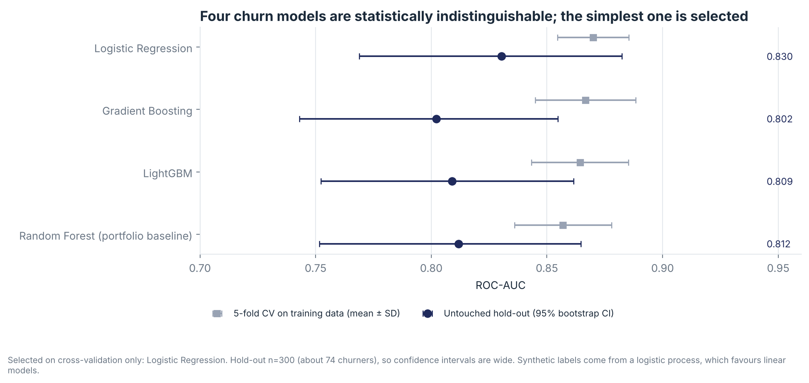

| Model | CV AUC | Hold-out AUC (95% CI) | PR-AUC | Brier |
|---|---|---|---|---|
| **Logistic Regression** (selected) | 0.870 | **0.830** (0.769 to 0.882) | 0.665 | 0.131 |
| Random Forest (portfolio baseline) | 0.857 | 0.812 (0.752 to 0.865) | 0.609 | 0.161 |
| LightGBM | 0.864 | 0.809 (0.752 to 0.862) | 0.596 | 0.146 |
| Gradient Boosting | 0.867 | 0.802 (0.743 to 0.855) | 0.587 | 0.151 |

The gradient-boosted models do not beat the regression here. That is an honest result: with 1,200 rows and mostly monotone effects, a transparent model is enough.

**Why customers leave (SHAP).** Complaints in the last 12 months, low app engagement and short tenure drive risk. A recent fee increase adds risk on top. Segment itself matters little once behaviour is known.

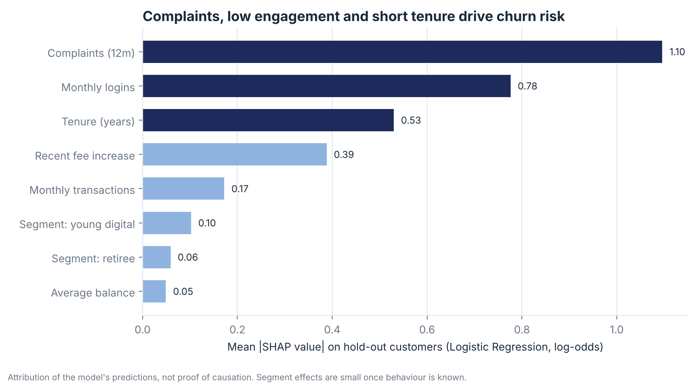

**How to read the score.** Ranking by risk concentrates churners (left), and the predicted probabilities track observed churn (right). Isotonic calibration was tested and **not applied** because it did not improve out-of-fold Brier score.

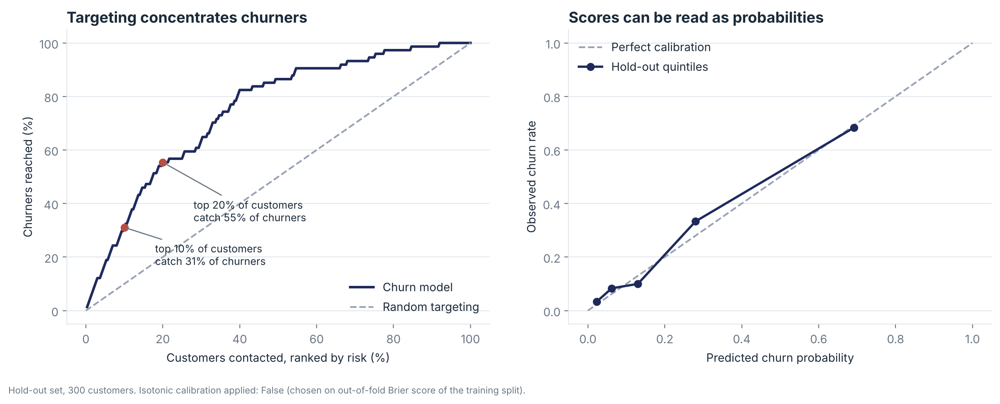

### 2. What is it worth, and who should be called?

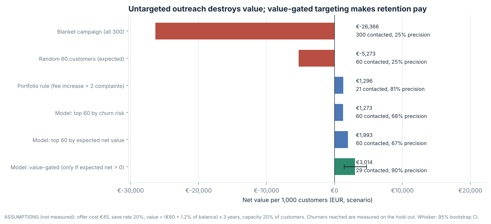

| Strategy (hold-out, scaled to 1,000 customers) | Contacted | Precision | Net value (scenario) |
|---|---|---|---|
| Blanket campaign | 300 | 25% | -€26,366 |
| Random 60 customers | 60 | 25% | -€5,273 |
| Portfolio rule (fee increase + 2 complaints) | 21 | 81% | +€1,296 |
| Model: top 60 by churn risk | 60 | 68% | +€1,273 |
| Model: top 60 by expected net value | 60 | 67% | +€1,993 |
| **Model: value-gated (contact only if expected net > 0)** | **29** | **90%** | **+€3,014** (95% CI +€1.4k to +€4.7k) |

The simple portfolio rule is a good baseline (81% precision), but it reaches only 23% of churners. The model-based list reaches more of them at similar precision.

**Sensitivity.** The result depends on two assumptions: the share of contacted would-be churners who are saved, and the cost of a contact. A fixed-size campaign (top 60) breaks even at a **16.5% save rate**; the value-gated policy never goes below zero because it skips unprofitable calls.

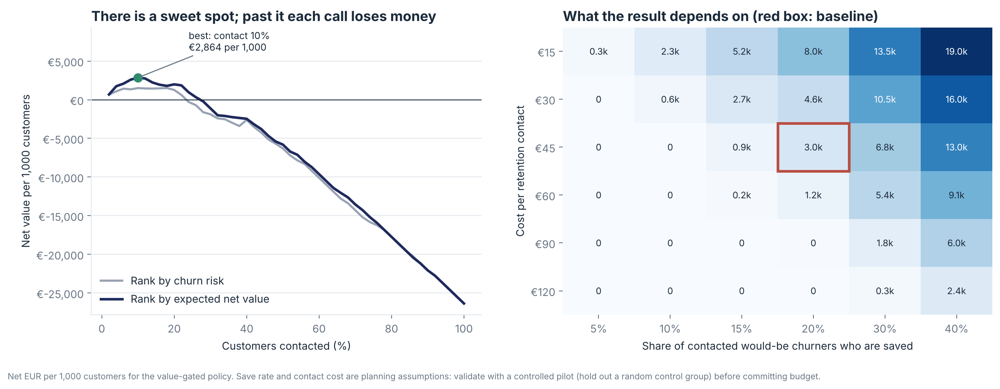

### 3. What are customers complaining about, and what does it cost?

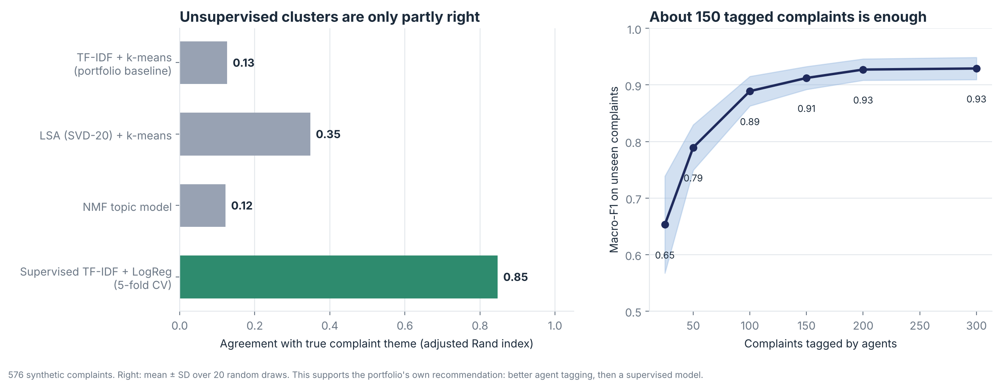

| Method | Agreement with true theme (ARI) | Macro-F1 |
|---|---|---|
| TF-IDF + k-means (portfolio baseline) | 0.13 | - |
| LSA + k-means | 0.35 | - |
| NMF topic model | 0.12 | - |
| **Supervised TF-IDF + LogReg (5-fold CV)** | **0.85** | **0.93** |

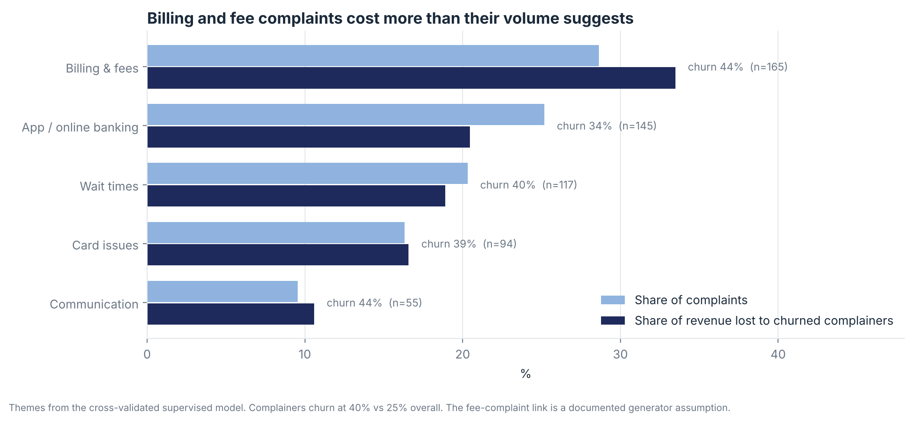

### 4. Which offer should an agent show?

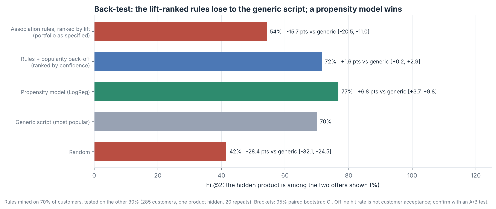

The portfolio's association rules (Apriori, support 8%, lift 1.1) are valid, but ranking recommendations by lift favours rare products. In a back-test (rules mined on 70% of customers, one product hidden per test customer, 285 test customers) they lose to the "most popular two products" script. A rules + popularity hybrid is slightly better than the script, and a logistic-regression propensity model is clearly better.

Scenario translation: if offer acceptance scales with the hit-rate ratio (baseline 3% acceptance, €35 margin), the propensity model adds about **€100 per 1,000 service contacts** (CI €55 to €147). This is deliberately modest. It is an offline proxy for acceptance, so treat it as a hypothesis for an A/B test.

### 5. Which BI architecture?

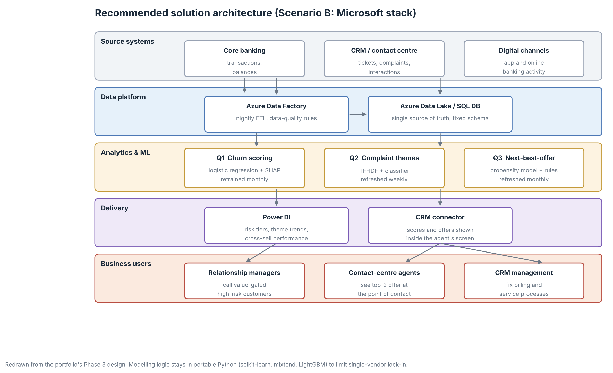

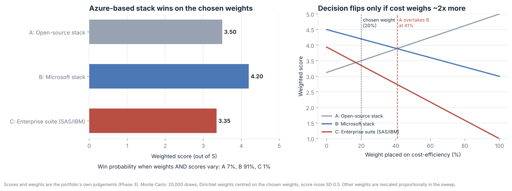

---

## Reproduce it

```bash
git clone https://github.com/maggotinho35/crm-retention-intelligence.git
cd crm-retention-intelligence
python -m venv .venv && source .venv/bin/activate      # Windows: .venv\Scripts\activate
pip install -r requirements.txt
python scripts/run_pipeline.py                         # about 30 seconds; writes data/, outputs/, images/
pytest -q                                              # 5 fast checks
```

Options: `--no-figures` (tables only), `--boot 300` (quicker bootstrap). Everything is seeded (`SEED = 42`), so reruns give identical numbers.

## Repository map

```
crm-retention-intelligence/
├── scripts/run_pipeline.py        one command: data -> models -> business value -> figures -> metrics.json
├── src/crm_bi/
│   ├── config.py                  seed, segments, and every business assumption (BusinessAssumptions)
│   ├── data_generation.py         documented synthetic bank data
│   ├── churn.py                   4 models, CV, bootstrap CIs, calibration check, SHAP
│   ├── business_impact.py         customer value, strategies, capacity curve, sensitivity, break-even
│   ├── complaints.py              TF-IDF/LSA/NMF discovery, supervised tagging, label-budget curve, theme -> money
│   ├── nbo.py                     Apriori rules, propensity model, leave-one-out back-test
│   ├── tool_selection.py          weighted scoring, Monte Carlo, flip point
│   ├── figures.py                 every figure, driven by the results (no hand-typed numbers)
│   └── viz.py                     palette and style
├── tests/test_smoke.py
├── docs/                          management brief, data dictionary, assumptions and limitations
├── data/                          generated CSVs (synthetic)
├── outputs/                       result tables and metrics.json
└── images/                        figures used in this README
```

## Limitations (please read)

- **Synthetic data.** The generator encodes relationships on purpose (for example, fee increases raise complaints and churn). Results show that the methods recover and monetise those relationships; they are not evidence about real customers.
- **Small hold-out.** 300 customers and 74 churners, so confidence intervals are wide (hold-out AUC CI 0.77 to 0.88). The value-gated list is only 29 customers.
- **Euro values are assumptions**, not measurements. The save rate (20%) is the weakest one. Run a randomised pilot with a held-out control group before committing budget.
- **Offline NBO accuracy is not acceptance.** Back-test hit rate is a proxy.
- **Unsupervised complaint clustering** was tuned with knowledge of the true labels (vectoriser settings), so its score is optimistic; the supervised result uses cross-validation.
- The original PDF's exact scores are not reproduced because the generator is a re-implementation calibrated to the documented statistics.

## Extending

Sentence-embedding complaint clustering, survival models for time-to-churn, uplift modelling (who is *persuadable*, not just who is likely to leave) and a live A/B test design are the natural next steps; see [`docs/assumptions_and_limitations.md`](docs/assumptions_and_limitations.md).

## Author

**Arthur Ebenezer**, Business Intelligence portfolio project. Licensed under the MIT License.
